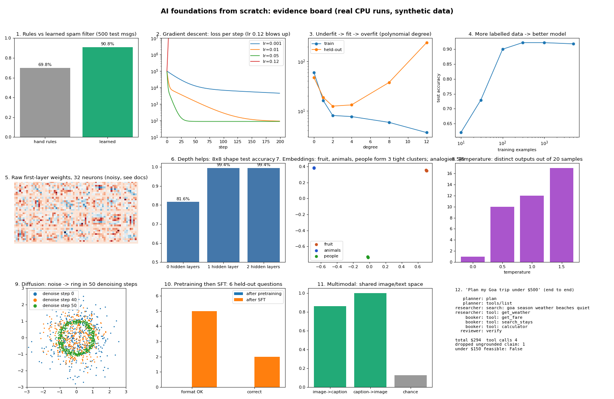
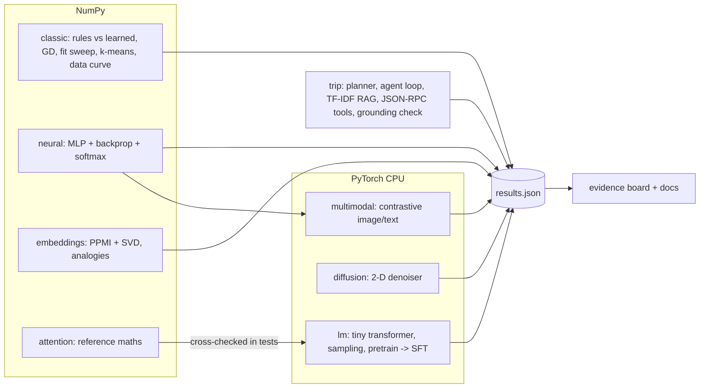

# AI foundations from scratch

**Recruiter summary.** The core ideas under modern AI, each built by hand and measured on a laptop CPU:
gradient descent, under- and over-fitting, a neural net with hand-written backprop, trained word
vectors, attention, a tiny transformer, temperature, pretraining then fine-tuning, a diffusion
model, a picture/caption model, and one agent request traced end to end. No paid APIs, no GPU,
no cloud. Every number below comes from `aifound demo` on synthetic data.

<!-- BEGIN:tests -->
**104 tests**
<!-- END:tests -->
run in CI on every push.

Ideas that other repos in this portfolio already prove (tokenizers, RAG, tools, MCP, multi-agent,
context windows, RL fine-tuning) are linked from [docs/coverage.md](docs/coverage.md) rather than rebuilt.



## Measured results

<!-- BEGIN:headline -->
| What | Measured (synthetic data, CPU) |
|---|---|
| Hand rules vs learned spam filter | 69.8% vs 90.8% on 500 test messages |
| Gradient descent, house prices | learned $120.8k per 100 m2 and $15.2k per room (true rule 120 / 15); step 0.12 diverges |
| Underfit vs overfit | held-out RMSE 47.3 (degree 0), 12.4 (degree 2), 240.8 (degree 12, train RMSE 3.6) |
| k-means, no labels | purity 1.0 on 150 laundry items |
| More data | spam accuracy 62.0% with 10 examples -> 91.8% with 5000 |
| Neural net depth | 0 hidden layers: 81.6%, 1 hidden layer (32): 99.4%, 2 hidden layers (32, 16): 99.4% |
| Embeddings | same-group cosine 0.997 vs fruit-animal 0.025; analogies 5/5 at 16 dims, 4/5 at 8 |
| Tiny transformer | val loss 3.526 -> 0.259 (1 layer), 0.187 (2 layers) |
| Temperature | distinct outputs of 20: T=0.0: 1, T=0.5: 10, T=1.0: 12, T=1.5: 17 |
| Pretraining -> SFT, held-out places | format 0/6 -> 5/6, correct 0/6 -> 2/6 |
| Diffusion | ring error 0.567 (noise) -> 0.065 after 50 steps (real data 0.016) |
| Multimodal | image->caption 86.0%, caption->image 100.0% (chance 12.5%) |
| Trip planner, $500 | total $294, 4 tool calls, 1 planted ungrounded claim dropped; $150 -> says no |
| Tests | 104 |
<!-- END:headline -->

Sample sizes are small and the data is generated in code, so read these as regression checks that
show each mechanism working, not as model-quality claims. Full output: [docs/results.md](docs/results.md).

## Purpose

For engineers and interviewers who want to see the moving parts, not just the vocabulary. Each
module is short enough to read in one sitting and has tests that pin its behaviour. See
[docs/purpose.md](docs/purpose.md).

## Architecture



More: [docs/architecture.md](docs/architecture.md), [docs/how-it-works.md](docs/how-it-works.md).

## Real code and output

Gradient descent, as written in `classic.py`:

```python
for _ in range(steps):
    err = xb @ w - y
    loss = float(np.mean(err**2))
    w -= lr * 2 * xb.T @ err / len(y)
```

Output (`results.json -> gradient_descent.best_fit`): `{"bias": 36.9, "per_100m2": 120.8, "per_room": 15.2}`
against the generating rule 40 / 120 / 15. More excerpts: [docs/code-and-output.md](docs/code-and-output.md).

## How to run

```bash
python -m venv .venv && . .venv/bin/activate
pip install torch==2.5.1 --index-url https://download.pytorch.org/whl/cpu
pip install -e ".[dev]"
aifound demo            # about 30 s; writes results/results.json and results/evidence_board.png
pytest -q
python scripts/render_docs.py   # copy the new numbers into the docs
```

Details: [docs/running.md](docs/running.md). There is no cloud path; nothing here costs money.

## Guardrails

Bad inputs (negative or non-finite budgets and costs, zero steps, unknown characters, extra tool
arguments) raise `SafeError`. Error text and logs go through a PII scrubber (Luhn-checked cards,
SSNs, emails, phones). Tool calls go through a fixed allow-list with type checks. The reviewer drops
any claim it cannot trace to a retrieved note or a tool that actually ran. See
[docs/guardrails.md](docs/guardrails.md) and [docs/threat-model.md](docs/threat-model.md).

## Limitations

Toy sizes, synthetic data, one seed. The 2012 point is shown only on the data side. RLHF is linked,
not rebuilt. The trip agent's decisions come from a scripted policy, not a model. PyTorch numbers can
shift slightly on another CPU. Full list: [docs/limitations.md](docs/limitations.md).

## Built vs planned

| Item | Status |
|---|---|
| Rules vs learned, gradient descent, fit sweep, k-means, learning curve (NumPy) | Built, tested, measured |
| MLP with hand-written backprop and numeric gradient check | Built, tested, measured |
| PPMI + SVD embeddings with analogies | Built, tested, measured |
| Attention reference + tiny transformer (cross-checked) | Built, tested, measured |
| Temperature sweep, pretrain -> SFT on held-out places | Built, tested, measured |
| Toy diffusion, contrastive multimodal | Built, tested, measured |
| End-to-end trip planner (RAG, JSON-RPC tools, agents, grounding) | Built, tested, measured |
| Preference tuning (RLHF/DPO) on the tiny transformer | Planned (DPO exists in agent-training-distill-rl) |
| GPU vs CPU timing for the "compute" half of 2012 | Planned (needs a GPU; not free) |
| Trip planner driven by a real language model | Planned (see Jagadish-agentic-ai for the model-driven loop) |

## Docs

[coverage](docs/coverage.md) · [trip walkthrough](docs/trip-walkthrough.md) · [implementation guide](docs/implementation-guide.md) ·
[interview points](docs/interview-points.md) · [ADRs](docs/adr)

## Related repos

[token-accounting](https://github.com/jagadishmazure-jpg/Jagadish-token-accounting) · [agent-training-distill-rl](https://github.com/jagadishmazure-jpg/Jagadish-agent-training-distill-rl) ·
[lora-finetuning](https://github.com/jagadishmazure-jpg/Jagadish-lora-finetuning) · [model-inference-lab](https://github.com/jagadishmazure-jpg/Jagadish-model-inference-lab) ·
[context-engineering](https://github.com/jagadishmazure-jpg/Jagadish-context-engineering) · [rag-optimization](https://github.com/jagadishmazure-jpg/Jagadish-rag-optimization) ·
[agentic-ai](https://github.com/jagadishmazure-jpg/Jagadish-agentic-ai) · [multi-agent-orchestration](https://github.com/jagadishmazure-jpg/Jagadish-multi-agent-orchestration) ·
[agent-auth-security](https://github.com/jagadishmazure-jpg/Jagadish-agent-auth-security)

MIT licence. All names, places-as-data, hotels and prices are invented sample data.
