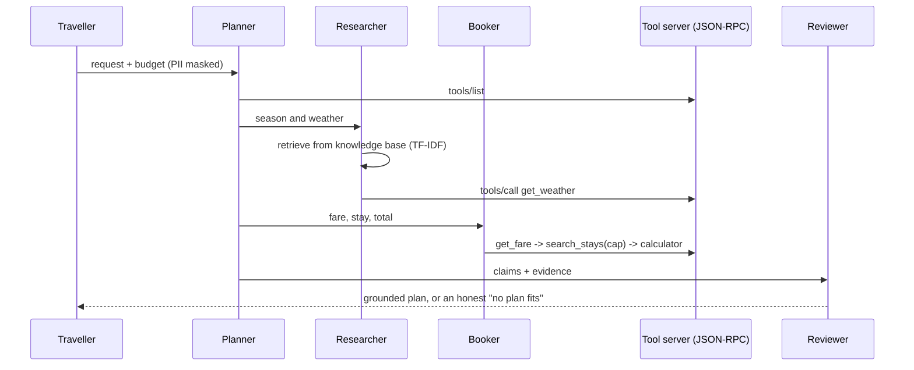

# Walkthrough: "plan my Goa trip under $500"

One request, followed through every layer. Code: `src/aifound/trip.py`. Run: `aifound demo`, then
read `results/results.json` -> `trip`. Hotels, fares and the forecast are invented sample data.

| Layer | What happens here | Bigger version elsewhere |
|---|---|---|
| Context window | history cut to 120 words; a pinned profile line survives the cut | Jagadish-context-engineering |
| Planner | fixed split into three jobs | Jagadish-multi-agent-orchestration |
| Agent loop | decide -> act -> observe, capped at 6 steps | Jagadish-agentic-ai |
| Retrieval | hand-written TF-IDF over 7 notes | Jagadish-rag-optimization |
| Tools / MCP | JSON-RPC 2.0, strict argument checks, negative numbers refused | Jagadish-agentic-ai `shared/mcp_servers` |
| Grounding | every claim must cite a retrieved note or a tool that really ran | Jagadish-agent-reliability-lab |
| Next-token brain | scripted policy here (exact, testable); `lm.py` shows the loop a model would run | Jagadish-model-inference-lab |

## Measured run

<!-- BEGIN:headline -->
| What | Measured (synthetic data, CPU) |
|---|---|
| Hand rules vs learned spam filter | 69.8% vs 90.8% on 500 test messages |
| Gradient descent, house prices | learned $120.8k per 100 m2 and $15.2k per room (true rule 120 / 15); step 0.12 diverges |
| Underfit vs overfit | held-out RMSE 47.3 (degree 0), 12.4 (degree 2), 240.8 (degree 12, train RMSE 3.6) |
| k-means, no labels | purity 1.0 on 150 laundry items |
| More data | spam accuracy 62.0% with 10 examples -> 91.8% with 5000 |
| Neural net depth | 0 hidden layers: 81.6%, 1 hidden layer (32): 99.4%, 2 hidden layers (32, 16): 99.4% |
| Embeddings | same-group cosine 0.997 vs fruit-animal 0.025; analogies 5/5 at 16 dims, 4/5 at 8 |
| Tiny transformer | val loss 3.526 -> 0.259 (1 layer), 0.187 (2 layers) |
| Temperature | distinct outputs of 20: T=0.0: 1, T=0.5: 10, T=1.0: 12, T=1.5: 17 |
| Pretraining -> SFT, held-out places | format 0/6 -> 5/6, correct 0/6 -> 2/6 |
| Diffusion | ring error 0.567 (noise) -> 0.065 after 50 steps (real data 0.016) |
| Multimodal | image->caption 86.0%, caption->image 100.0% (chance 12.5%) |
| Trip planner, $500 | total $294, 4 tool calls, 1 planted ungrounded claim dropped; $150 -> says no |
| Tests | 104 |
<!-- END:headline -->

Notes from the run:

- With $500 the booker caps the nightly price at (budget - fare - food) / nights and takes the best
  stay under that cap. The planted claim "the beach is free of any entry fee all year" has no source,
  so the reviewer drops it.
- With $150 nothing fits after fare and food, and the answer says so instead of inventing a hotel.
- Retrieval ranks the scooter note second for a "beaches" query because both share that word. That
  is a real weakness of plain keyword scoring and is why the RAG repo adds reranking.
